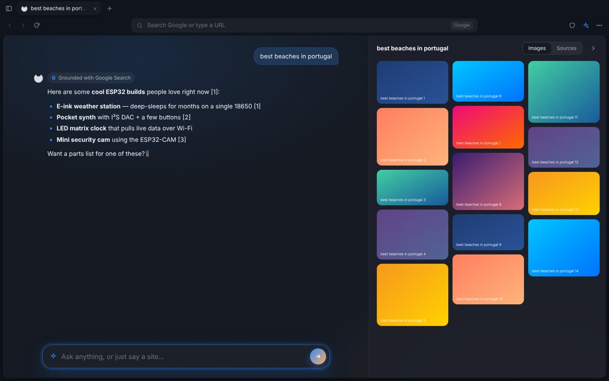
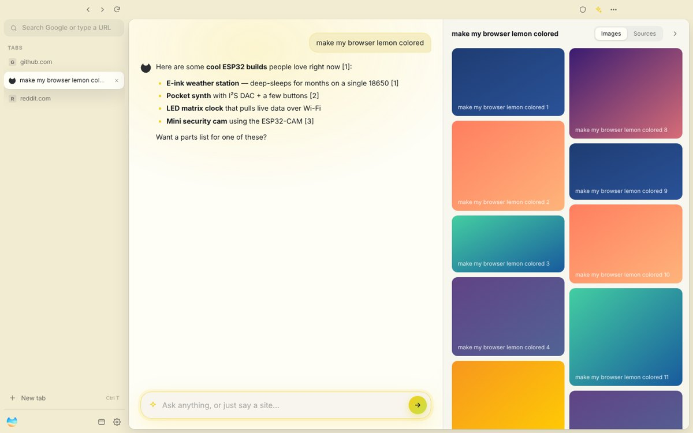
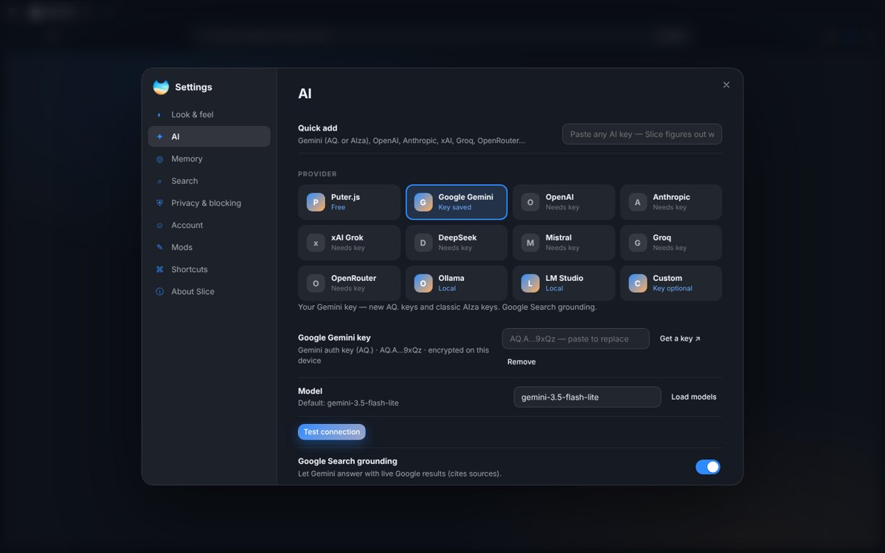

<p align="center">
  
</p>

<h1 align="center">Slice</h1>
<p align="center"><b>Say it. Slice does it.</b><br>An AI-native browser for Windows. Built on Blink, with uBlock Origin built in.</p>
<p align="center"><a href="https://thatmaxwell.github.io/Slice/">Website</a> · <a href="https://github.com/ThatMaxwell/Slice/releases/latest">Download</a> · <a href="RESEARCH.md">Design research</a></p>

<p align="center"></p>

---

## What it does

**The new tab is an AI bar.** Type anything:

| You say | Slice does |
|---|---|
| `yo` | opens YouTube. No AI round-trip. Same for `reddit`, `gh`, `insta`, `r/esp32`, any URL… |
| `hey!` | talks back, and the right-hand panel still fills with images |
| `2026 news`, `is … true?` | runs a quick web search, reads the top 3 pages (hard 3 s budget), answers with clickable citations |
| `whats ur ai model?` | just answers. No search needed |
| `make my search default brave search and make my browser look lemon colored!` | switches the engine to Brave and the theme to Lemon on its own |

**Every prompt opens the results panel.** It shows a skeleton first, then images, plus a Sources tab whenever the web was searched.

**The top bar is a plain search box.** It sends you to Google by default (or Brave, DuckDuckGo, Bing, Startpage, Ecosia, Kagi, Perplexity, Qwant, Mojeek, Yahoo, or a custom URL). No AI there.

**Chat with any page.** <kbd>Ctrl</kbd> <kbd>J</kbd> opens a Dia-style sidebar that reads the current tab. You can also select text, right-click, then "Ask Slice about…".

### The AI: any AI you like
- **Free by default:** Google's newest Flash-Lite, **`gemini-3.5-flash-lite`**, through [Puter.js](https://docs.puter.com/). You sign in to Puter once. Puter also gives free access to Claude, GPT-6, Grok, DeepSeek, Mistral and Qwen, so you can pick one in Settings → AI.
- **Bring your own key:**

  | Provider | How Slice talks to it |
  |---|---|
  | **Google Gemini** | native API, with Google Search grounding and a context-cached system prompt. **New `AQ.` auth keys and classic `AIza` keys both work** |
  | **Anthropic** | native Messages API, with the system prompt marked for prompt caching |
  | **OpenAI**, **xAI Grok**, **DeepSeek**, **Mistral**, **Groq**, **OpenRouter** | OpenAI-compatible APIs |
  | **Ollama**, **LM Studio** | local models, no key needed |
  | **Custom** | any OpenAI-compatible URL |

- **Paste any key and Slice works out who it belongs to:** `AQ.`/`AIza` → Gemini, `sk-ant-` → Anthropic, `xai-` → xAI, `gsk_` → Groq, `sk-or-` → OpenRouter, `sk-` → OpenAI.
- **Load models** pulls the provider's live model list. **Test connection** sends one tiny request and tells you exactly what's wrong, if anything.
- **Keys live in an encrypted vault.** They're encrypted with the OS keychain (DPAPI on Windows), stay in the main process, and are only sent to that provider. Stray quotes, spaces and `Bearer ` get stripped when you paste.
- **Cached system prompt:** built once at launch from your fine-tunes, taste profile and instructions.
- **Browser automation:** the AI drives Slice through a small, whitelisted action protocol: `open`, `search`, `read`, `set` (theme, accent, engine, layout, compact, glass, radius, font, AI provider…), `remember`, `forget`, `newTab`, `closeTab`. The main process validates every change. The AI can only switch to providers that already have a key.

#### About Gemini `AQ.` keys
In 2026 Google AI Studio started issuing **auth keys** (`AQ.…`) in place of the old standard `AIza…` keys. Many apps broke because they check for the `AIza` prefix or call Google's OpenAI-compatible endpoint, which rejects auth keys. Slice:
- never checks the prefix
- always calls the **native** Gemini API, even when a Gemini key is pointed at Google's OpenAI-compatible URL
- sends the key in the `x-goog-api-key` header first, then tries `?key=`, then (for `AQ.` keys) a Bearer token, and remembers which one that key accepts
- turns Google's confusing "Expected OAuth 2 access token" error into plain English

### Memory with manners
Slice learns your taste from your searches, and learns how you talk too (lowercase, slang, emoji, message length), so it can act like an actual partner. Everything stays on your device in `memory.json`.
- **Private:** health, mental health, sex and dating, money and legal trouble, passwords, emails, phone numbers, addresses. These are **never stored and never shown to the AI**. Only a count is kept.
- **Discarded:** throwaway input like `yo`, `hey`, bare site names and URLs.
- **Kept:** everything else. It gets summarised into interests, recent topics and style notes for the cached prompt.

You can view, delete or pause all of it in Settings → Memory. Private tabs (<kbd>Ctrl</kbd> <kbd>Shift</kbd> <kbd>N</kbd>) are never recorded.

### Super customizable
- 12 themes (Shore, Daylight, Lemon, Midnight, Sakura, Forest, Sunset, Ocean, Grape, Mint, Mono, Paper), plus custom accent and glow colours and a colour-intensity slider
- **Top tabs or sidebar** (Arc / Zen style), resizable
- **Compact mode:** the toolbar or sidebar hides until you hover
- **Glass mode:** Mica, Acrylic or Tabbed on Windows 11 (vibrancy on macOS). The frame blurs your wallpaper and pages stay opaque
- Corner radius, density, fonts, interface size, animations, site-colour tinting (the toolbar takes on the page's theme colour, like Dia), home button
- **Mods:** your own CSS for the browser frame, plus theme export and import
- Six onboarding **fine-tunes** (Bestie, Researcher, Maker, Minimalist, Creative, Student) that set personality and defaults

<p align="center"> </p>

### Private and fast
- **Blink engine** (Chromium 152 via Electron 44)
- **De-Googled:** background networking, component updater, domain reliability, sync, pings, Translate, Media Router, optimisation hints and Privacy Sandbox ad APIs (Topics / FLEDGE) are switched off. The user agent reads as plain Chrome with no "Electron" token
- **uBlock Origin lists on by default:** uBO filters, badware, privacy, quick-fixes, unbreak, resource-abuse, EasyList, EasyPrivacy and Peter Lowe's. They're compiled into [Ghostery's uBO-compatible engine](https://github.com/ghostery/adblocker) (network blocking, cosmetic filtering, scriptlets) and cached for a week
- Global Privacy Control and DNT headers, a per-site permission prompt, and downloads straight to your Downloads folder

### Setup: three clicks
1. **Continue with Google.** This uses OAuth 2.0 for desktop apps (system browser, loopback redirect and PKCE), because Google blocks sign-in inside embedded webviews.
2. **Pick your fine-tunes.**
3. **Start browsing.**

## Run it

```bash
npm install
npm start          # launch Slice
npm run check      # syntax + privacy-filter checks
npm run paparazzi  # screenshot the site + browser UI on desktop, iPhone 17, iPhone Duo (folded/unfolded/split), iPad
npm run dist:win   # build the NSIS installer and portable .exe into dist/
```

Pushing a tag like `v0.1.0` runs `.github/workflows/release.yml`. It builds the Windows installer and portable `.exe` on GitHub Actions and attaches both to the release.

### Google sign-in
Create an OAuth client of type **Desktop app** in Google Cloud Console → Credentials. Then give Slice the ID in one of three ways:
- Settings → Account → OAuth client ID
- the `SLICE_GOOGLE_CLIENT_ID` (and optionally `SLICE_GOOGLE_CLIENT_SECRET`) environment variables
- `src/main/oauth.config.json` → `{ "clientId": "…", "clientSecret": "…" }` (this file is git-ignored)

Without a client ID, the button explains that and lets you continue.

### Paparazzi (screenshots on every device)
[Paparazzi](https://github.com/cashapp/paparazzi) is Cash App's screenshot-testing tool for Android. `scripts/paparazzi.js` does the same job for Slice's web code. It renders the website and the browser UI on desktop, iPhone 17, iPhone 17 Pro Max, iPhone Duo (folded 466×678, unfolded 890×626, Split View 445×626), iPad, and a Duo being unfolded mid-visit. Shots go to `paparazzi/` with a `contact-sheet.png`. **It fails if any page scrolls sideways on any device.** Run `npx playwright install chromium` once first, or set `PAPARAZZI_CHROME` to any Chrome.

### Website
The site lives in [`docs/`](docs/). It's built mobile-first: it uses `dvh` units and safe-area insets (rounded corners, under-display camera), has a dedicated layout for short-and-wide screens like the unfolded iPhone Duo, re-fits the live demo when the phone folds or unfolds, and supports the `viewport-segments` media query for dual-screen foldables. To publish it, open **Settings → Pages**, choose **Deploy from a branch**, and pick `main` / `docs`. It will be served at https://thatmaxwell.github.io/Slice/.

## How it's built

```
src/
  main/            Electron main process
    main.js        window, de-Googled flags, sessions, permissions, downloads, IPC
    ai.js          Gemini (AQ. + AIza, context cache, grounding), Anthropic, OpenAI-compatible; models + test
    keys.js        encrypted API-key vault (safeStorage)
    search.js      fast web search (Brave API → DuckDuckGo → Bing), page reader, image search
    memory.js      taste memory + privacy classifier
    adblock.js     uBlock Origin lists in the Ghostery engine
    oauth.js       Google OAuth (loopback + PKCE)
  renderer/        the browser UI (served from a fixed 127.0.0.1 origin so Puter.js can sign in)
    js/ai.js       routing ("yo"), web heuristics, cached system prompt, Puter.js, action parsing
    js/chat.js     conversation engine shared by the new tab and the page assistant
    js/tabs.js     tabs as <webview>s (Blink), top or sidebar strips
    js/ntp.js      new tab page + results panel
    js/settings.js, onboarding.js, assistant.js, app.js
  shared/config.js search engines, themes, fine-tunes, defaults, what the AI may change
docs/              the website (GitHub Pages)
```

### Honest notes
- **"Ungoogled Chromium":** Slice runs Blink through Electron's Chromium build. It isn't a fork of the ungoogled-chromium project. Electron already ships without Google accounts, sync, Safe Browsing and Google Update, and Slice switches off the remaining phone-home features with flags.
- **"uBlock Origin":** Electron can't run the full uBO extension, so Slice runs uBO's own filter lists natively in a uBO-compatible engine.
- **Web search** uses free endpoints (DuckDuckGo, then Bing). For production reliability, add a Brave Search API key in Settings → AI, or use a Gemini key with Google grounding.
- **Coming soon:** Slice for Android, Slice Mini, Slice Pro.
